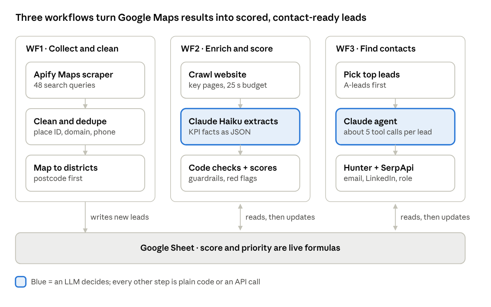
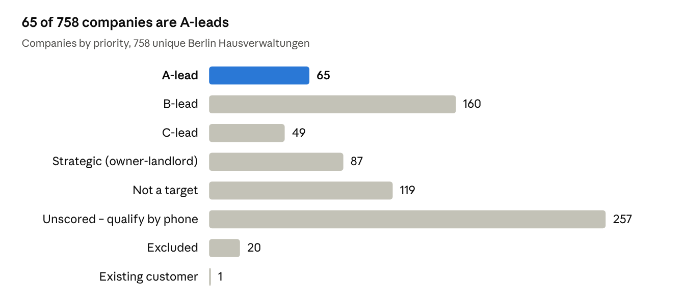

# AI Lead Scoring Pipeline

An n8n pipeline that finds every property management company (Hausverwaltung) in Berlin, reads each company's website with Claude, scores how well it fits a target customer profile, and uses an AI agent to find the right person to contact.

Built as a case study for a B2B proptech company that sells metering and heating-cost billing to property managers.



## Results

| Stage | Companies |
| --- | --- |
| Raw Google Maps results (48 searches) | 985 |
| Unique after cleaning and dedupe | 758 |
| Enriched from their website and scored | 500 |
| A-leads (score ≥ 75) | 65 |
| A-leads with a named decision-maker / personal email | 63 / 33 |

- **Cost:** about $13 for the whole run, roughly $0.02 per company
- **Accuracy:** a spot-check of 10 companies against independent sources (company registers, directories, job ads, reviews) found **41 of 43 fields correct (95.3%)**



## How it works

The three workflows share one Google Sheet, so each can be rerun on its own.

### WF1 – Collect and clean
- An Apify Google Maps run with **48 searches: 12 Berlin districts × 4 keywords** (Hausverwaltung, WEG-Verwaltung, Immobilienverwaltung, Mietverwaltung), up to 25 places each. Searching district by district finds far more companies than one city-wide search.
- A code node cleans names and URLs, drops closed and non-Berlin places, maps postcodes to districts, and **dedupes on place ID → website domain → phone**, keeping the entry with the most reviews. This removed 227 duplicates (23%).

### WF2 – Enrich and score
1. **Segment:** Google categories decide which companies are worth an LLM call; brokers and housing companies are routed differently.
2. **Crawl website:** homepage plus up to 5 key pages (Impressum, services, about, team), with listing and news pages skipped, repeated menu text removed, and a 25-second budget per site.
3. **Claude Haiku extracts** the KPI facts as JSON ([prompt](prompts/extraction_prompt.md)).
4. **Code checks and scores:** guardrails correct known LLM mistakes, then a 100-point score and red flags are calculated in plain code.

### WF3 – Contact agent
An n8n AI Agent (Claude Sonnet first, later Haiku to save cost) with three tools: **Hunter domain search**, **Hunter email finder** and **Google search via SerpApi**. It looks for the best decision-maker at each top lead, plus a business email and LinkedIn profile ([prompt](prompts/agent_system_prompt.md)).

The agent is allowed to return "not found", and every email is labelled with where it came from:

| Result on 33 leads | Leads |
| --- | --- |
| Email verified by Hunter | 16 |
| Email found, not verified | 5 |
| Email pattern guess (labelled as such) | 3 |
| Email from the company website | 1 |
| Not found (honest null) | 8 |
| LinkedIn profile found | 11 |

## Scoring model

The KPIs were derived from the traits shared by the company's existing customers, so each lead is scored on how much it looks like a company that already buys.

| KPI | Points |
| --- | --- |
| Core business: property management (mixed: 8) | 15 |
| Manages WEGs (condominium associations) | 15 |
| Manages whole buildings, not single flats | 10 |
| Does the cost billing itself | 10 |
| Residential focus (mixed: 5, unknown: 3) | 10 |
| Size: Large/Medium (proxy 7, Small 5, unknown 3) | 10 |
| Digital maturity: high (medium 6, basic 2) | 10 |
| VDIV member | 10 |
| Energy signal | 5 |
| Growth signal | 5 |

**A ≥ 75, B ≥ 55.** Red flags override the score: brokers, owner-landlords, commercial-only, own metering, single-flat management only, existing customers and no Berlin presence each get a label instead of a letter. Companies with too little website content are marked "Unscored – qualify by phone" rather than given a misleadingly low score.

## Design decisions

- **The LLM extracts, code double-checks.** Claude only turns website text into facts. Scoring, red flags and priorities are deterministic code, so the same input always gives the same result and every point is traceable (`score_breakdown` column).
- **An agent only where the task is open-ended.** Finding a contact depends on what the last tool returned, so an agent fits. Scoring doesn't, so it stays in code: faster, free and repeatable.
- **Evidence for every lead.** Each row keeps the URLs it was scored from, so any claim can be checked in one click.

## Lessons learned

Every guardrail was added after a real error in a test run.

| What went wrong | Fix |
| --- | --- |
| Claude marked a company as doing the billing from generic service text | Stricter prompt rule; code also sets billing to yes when a billing keyword is on the page but Claude missed it |
| Claude missed a company's WEG team | Case-sensitive WEG keyword check in code |
| Claude invented plausible personal emails | A personal email is kept only if it actually appears on the website |
| The agent's page-fetch tool guessed URLs and reasoned from 404 pages | Tool removed; the agent was more accurate with fewer tools |
| The run crashed at n8n's 300-second task timeout | Batches of 5, an 8-second fetch timeout and a 25-second budget per site |
| Google Sheets read quota (60/min) exceeded | Retry on fail: 5 tries, 30 seconds apart |

## Repository structure

```
├── workflows/
│   ├── WF1_Collect_and_clean.json
│   ├── WF2_Enrich_and_score.json
│   └── WF3_Contact_agent.json
├── prompts/
│   ├── extraction_prompt.md
│   └── agent_system_prompt.md
├── sample_data/
│   └── sample_leads.csv      # 8 made-up rows showing the output format
└── docs/
    ├── pipeline_diagram.png
    └── priority_chart.png
```

## How to run it

1. **Import** the three files from `workflows/` into n8n (Workflows → Import from File).
2. **Create credentials** in n8n with these names: `Apify API` (Header Auth, `Authorization: Bearer <token>`), `Google Sheets account`, `Anthropic account`, `Hunter API` (Query Auth, `api_key`) and `SerpAPI account`.
3. **Create a Google Sheet** with a `Leads` tab using the columns in `sample_data/sample_leads.csv`, and replace `YOUR_SHEET_ID` in every Google Sheets node.
4. **Run the Apify Google Maps Scraper** (`compass/crawler-google-places`) with your search terms.
5. **Run WF1, then WF2, then WF3.** WF2 only processes rows with status `new`, so it can be stopped and restarted safely. In WF3, the `Limit (Hunter credits)` node controls how many leads are researched per run.

## Limitations and next steps

- Data comes only from company websites, so 257 companies with thin or unreachable sites need a phone call to qualify.
- Company status is not checked: one A-lead turned out to be liquidated. A Handelsregister check is the most valuable next step.
- More sources (the VDIV member directory, Gelbe Seiten) would improve coverage and size estimates.
- Other cities only need new search terms and a new postcode-to-district map.

## Data and privacy

No real lead data is published in this repository. The sample CSV uses made-up companies, people and `.example` domains. The original list was built from public business sources only, and API keys stay in n8n credentials.

## Tech stack

n8n (self-hosted, Docker) · Claude (Haiku, Sonnet) · Apify · Hunter.io · SerpApi · Google Sheets · JavaScript
